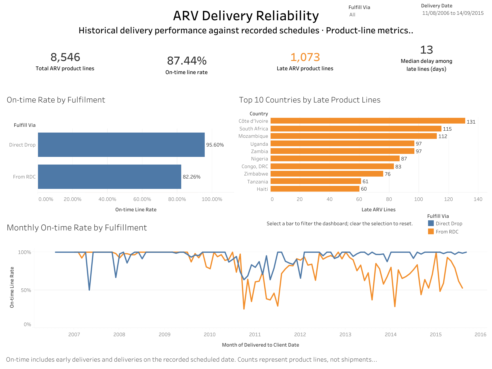
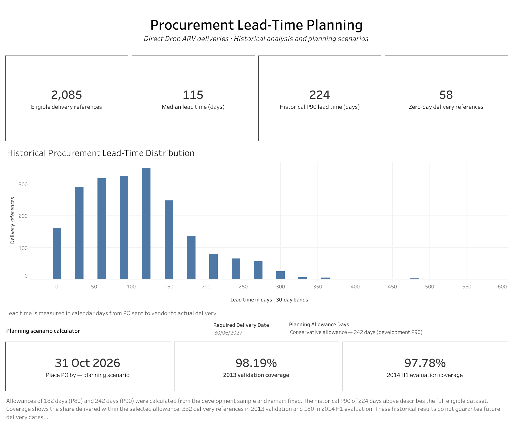

# Procurement Lead-Time Risk for HIV Medicines

A Python and Tableau case study examining how early procurement teams should place Direct Drop antiretroviral (ARV) orders, and how reliably ARV product lines arrive against their recorded schedules.

**Tools:** Python, pandas, Matplotlib, Jupyter, ipywidgets and Tableau.

## Key findings

- Across **2,085 eligible Direct Drop ARV delivery references**, median PO-to-delivery lead time was **115 calendar days** and the full-sample 90th percentile was **224 days**.
- Long lead times did not necessarily indicate late delivery: the five longest intervals matched their recorded scheduled dates.
- Among **8,546 ARV product lines**, **95.60%** of Direct Drop lines and **82.26%** of From RDC lines arrived on or before their recorded schedules. These descriptive differences do not establish causation.
- A **242-day planning allowance**, calculated from development data, covered **98.19%** of 2013 validation references and **97.78%** of January–June 2014 evaluation references.
- Country-specific P90 rules with an overall fallback achieved approximately **82% validation coverage** and were not adopted as a replacement for the overall rule.

## Dashboards

### ARV Delivery Reliability

Tracks product-line volumes, on-time rates, late-arrival severity, country patterns and monthly punctuality. On-time includes early deliveries and deliveries on the recorded scheduled date.



### Procurement Lead-Time Planning

Shows historical lead-time statistics and a distribution chart, alongside an interactive order-by-date scenario calculator.



Dashboard previews are provided here. An unrestricted interactive dashboard link has not yet been added.

## Data and scope

Download location: [Supply Chain Shipment Pricing Data on Kaggle](https://www.kaggle.com/datasets/apoorvwatsky/supply-chain-shipment-pricing-data), uploaded by Apoorv Patne.

The input contains **10,324 rows and 33 columns**. A fresh download from this listing was compared with the project input and found to be byte-for-byte identical.

Kaggle's displayed licence label is **“Data files © Original Authors”**. This attribution does not specify an explicit redistribution licence. This README does not grant rights to the source data. Raw data, derived CSVs and the data-containing Tableau workbook are kept locally pending confirmation of redistribution terms.

The notebook expects the filename `SCMS_Delivery_History_Dataset_20150929.csv` and reads it using `cp1252` encoding.

### Cleaning and units of analysis

- Parsed five date columns using explicit formats; preserved the original input values separately in memory.
- Excluded five records with actual delivery before the PO date, leaving 10,319 rows before product filtering. Four also had scheduled delivery before the PO date.
- Retained and flagged three records with recording dates one day before actual delivery.
- Selected 8,546 ARV product lines for punctuality analysis, including both fulfilment methods.
- Selected 3,055 Direct Drop ARV lines with usable PO dates for lead-time analysis, then aggregated to 2,085 ASN/DN references after checking consistency.
- Retained 58 zero-day delivery references and assessed sensitivity to their inclusion.
- Preserved differing scheduled dates at product-line level rather than choosing one schedule for each reference.

**Lead time:** actual delivery date minus PO sent-to-vendor date.  
**Delivery delay:** actual delivery date minus recorded scheduled date.  
Both measures use calendar days. Product-line counts, delivery-reference counts and order counts are distinct.

## Planning-rule evaluation

Development used **1,228 delivery references completed before 1 January 2013**. Validation used **332 references across 270 orders placed during 2013**. Separate-period evaluation used **180 references across 141 orders placed during January–June 2014**. The code checks that orders do not overlap between these samples.

| Scenario | Development-based allowance | 2013 validation coverage | 2014 H1 evaluation coverage |
|---|---:|---:|---:|
| Shorter allowance: P80 | 182 days | 87.05% | 90.56% |
| Conservative allowance: P90 | 242 days | 98.19% | 97.78% |

The 242-day scenario was selected as a conservative historical planning rule after comparing overall and country-level alternatives. It is not a financially optimal allowance or a guaranteed service level. The **224-day full-sample P90** is descriptive and is different from the **242-day development P90** used in the calculator.

The calculator subtracts the selected allowance from a required delivery date. For **30 June 2027**, it returns **30 December 2026** for 182 days and **31 October 2026** for 242 days. This is an illustration of date arithmetic, not a current operational recommendation.

## Project files

| Path | Purpose |
|---|---|
| `notebooks/01_data_audit.ipynb` | Complete audit, analysis, evaluation and calculator |
| `requirements.txt` | Package versions from the working environment |
| `images/` | Dashboard preview images |
| `data/` | Locally downloaded source CSV |
| `outputs/tableau/` | Two CSVs generated by the notebook for Tableau |
| `dashboards/` | Local packaged Tableau workbook backup |

## Run the analysis

The notebook was run with **Python 3.13.9** and the package versions in `requirements.txt`.

1. Download this project and the source dataset from the Kaggle listing above.
2. Place the CSV in `data/` and name it `SCMS_Delivery_History_Dataset_20150929.csv`.
3. Open a terminal in the project root and create an environment:

```bash
python3 -m venv .venv
source .venv/bin/activate
python -m pip install -r requirements.txt
python -m notebook
```

On Windows, use `.venv\Scripts\activate` to activate the environment.

4. Open `notebooks/01_data_audit.ipynb` and run all cells in order.
5. Use the date picker to explore planning scenarios, or call:

```python
display(calculate_order_by_dates("2027-06-30"))
```

The final export cells create `outputs/tableau/arv_delivery_reliability.csv` with 8,546 product lines and `outputs/tableau/arv_procurement_lead_time.csv` with 2,085 delivery references. The saved example output can be viewed without running the interactive widget.

## Limitations

- Results describe historical completed deliveries; missing, unfinished and cancelled deliveries cannot be assessed. Completion-based sampling can underrepresent long or unfinished orders.
- Recorded schedules may differ from original commitments, and administrative recording delays are not incorporated into the chronological split.
- Delivery references within the same order are not independent. Reference-level summaries give more weight to orders with more deliveries; selected comparisons include an order-balanced sensitivity check.
- Zero-day records materially affect some vendor summaries, and small country or vendor samples limit generalisation.
- The separate evaluation period appeared in exploratory analysis, so it is not a fully untouched holdout.
- Inventory costs, shelf life, holidays and supplier constraints are outside the calculator's scope. Historical coverage does not guarantee future performance.
